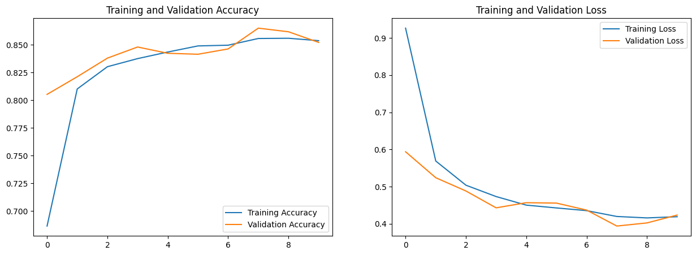
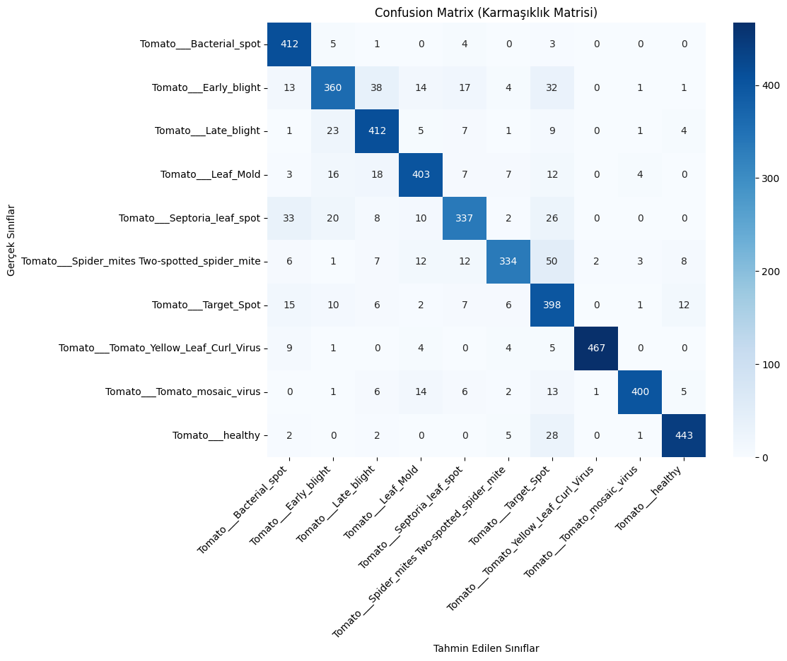

# Plant Disease Detection with Deep Learning

Train a MobileNetV2 image classifier on tomato leaf images using a Google Colab notebook.

The project demonstrates transfer learning, augmentation, validation curves, per-class evaluation, and a small image-prediction demo. The dataset and trained checkpoint are not included in this repository.

## Key Features

- A frozen ImageNet-pretrained MobileNetV2 feature extractor.
- Global average pooling, dropout, and a softmax classification head.
- Image resizing to 224 × 224 and training-time geometric augmentation.
- Early stopping and best-validation-accuracy checkpoint saving.
- Confusion matrix, classification report, and up to 16 demo predictions.

## Tech Stack

Python, Google Colab, TensorFlow/Keras, NumPy, Matplotlib, Seaborn, and scikit-learn. [requirements.txt](requirements.txt) lists Python dependencies; `google.colab` is supplied by Colab rather than a standard local installation.

## Architecture & Project Structure

```text
.
├── Plant_Disease_Detection.ipynb  # Drive setup, training, evaluation, demo
├── Graphics/
│   ├── PDD0.png                  # Historical training curves
│   └── PDD1.png                  # Historical confusion matrix
├── requirements.txt
└── LICENSE
```

The first code cell mounts Drive and copies an external dataset into Colab's local disk. Training reads separate `train/` and `valid/` directories. The next cell evaluates validation images without shuffling and displays example predictions. Class names and output-head size are inferred from the training subdirectories.

The original experiment describes ten tomato conditions: Bacterial Spot, Early Blight, Late Blight, Leaf Mold, Septoria Leaf Spot, Spider Mites, Target Spot, Yellow Leaf Curl Virus, Mosaic Virus, and Healthy. The actual supplied dataset determines the labels.

## Getting Started

1. Open [the notebook in Colab](https://colab.research.google.com/github/MustafArikan/Plant-Disease-Detection-with-Deep-Learning/blob/main/Plant_Disease_Detection.ipynb).
2. Obtain a tomato-leaf image dataset under its source license and upload it to your Drive.
3. Select a GPU runtime if available; CPU training is possible but slower.
4. Install dependencies in a notebook cell if the selected runtime needs them:

```python
%pip install -r requirements.txt
```

That command requires the repository to be present in the notebook's current directory. A local dependency installation alone cannot run the notebook unchanged because it imports `google.colab` and uses `/content` paths.

## Configuration

Edit the paths in the notebook before running:

| Setting | Purpose |
|---|---|
| `DRIVE_KAYNAK_YOLU` | Drive directory containing `train/` and `valid/` |
| `COLAB_HEDEF_YOLU` | Local Colab copy, initially `/content/temp_data` |
| `model_save_path` | Writable Drive destination for the best `.h5` checkpoint |
| `grafik_yolu` | Training-curve destination |
| `VAL_DIR` | Copied validation directory |
| `TEST_DIR` | Optional directory containing demo images |

Create the parent output directory before training. The later confusion-matrix and demo `savefig` calls also use Drive paths; update those destinations together. Training and validation directories must contain the same class subdirectories. No API credentials are needed beyond authorizing your own Drive mount.

## Usage

Run the setup/training cell first, then the evaluation/demo cell. The defaults use batch size 32 and up to ten epochs; early stopping monitors validation loss while the saved checkpoint monitors validation accuracy. The in-memory model and saved checkpoint can therefore represent different epochs.





These are historical artifacts, not newly reproduced benchmark results. No accuracy guarantee or class-balance claim is made for an unspecified external dataset.

## Testing

There is no automated test suite. Meaningful validation requires the external image dataset: verify class-index mappings, run training, inspect held-out predictions, and reproduce the classification report. A dependency-resolution check or notebook syntax check does not validate model quality.

## Development & Quality

Use an isolated environment for dependency experiments. Record TensorFlow, Keras, CUDA/runtime versions, dataset provenance, split rules, and random seeds alongside any new measurements. The current dependency ranges are not a reproducibility lock.

## Roadmap

- Make dataset and output paths configurable for local execution.
- Align input preprocessing with the pretrained MobileNetV2 contract and retrain before comparing metrics.
- Add a genuinely independent test set, deterministic seeds, and dataset checks.
- Add a small inference interface after validating a redistributable checkpoint.

## Contributing

Provide dataset provenance and permission to share any example images. Include the runtime, class mapping, split procedure, and validation results with model changes. Do not commit personal Drive contents or model artifacts without a clear distribution policy.

## License

Code is distributed under the [MIT License](LICENSE). Dataset and pretrained-weight terms are separate.

## Author

[Mustafa Arıkan](https://github.com/MustafArikan)
